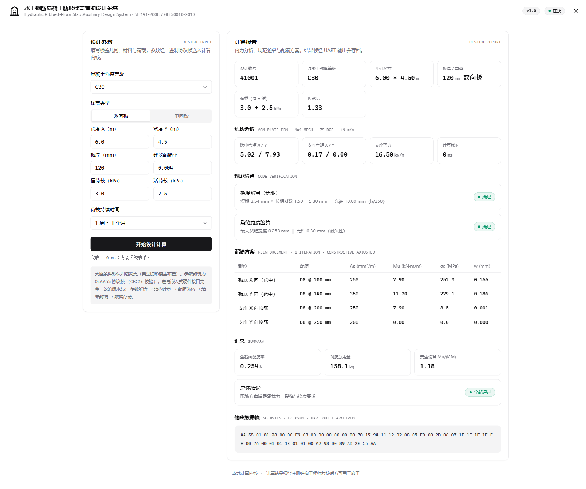
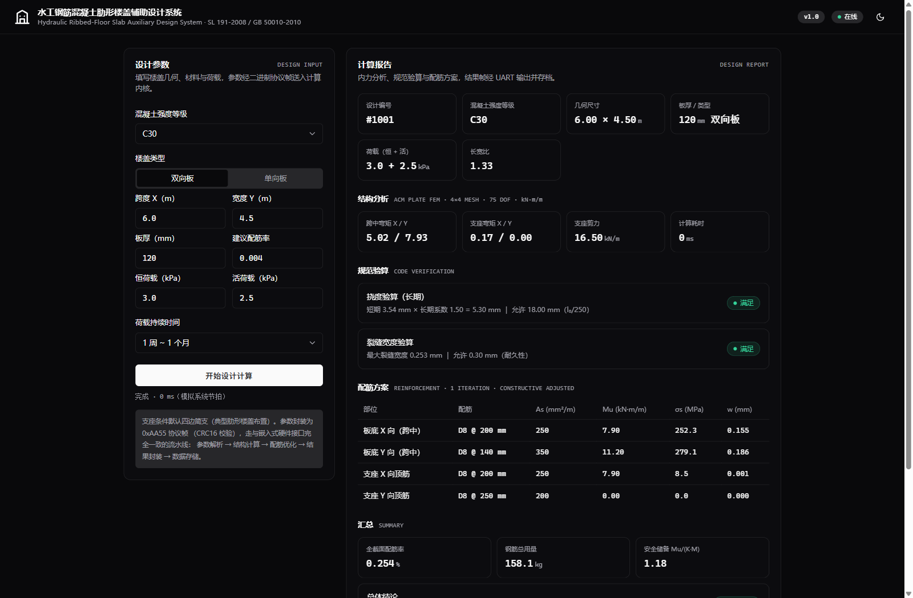
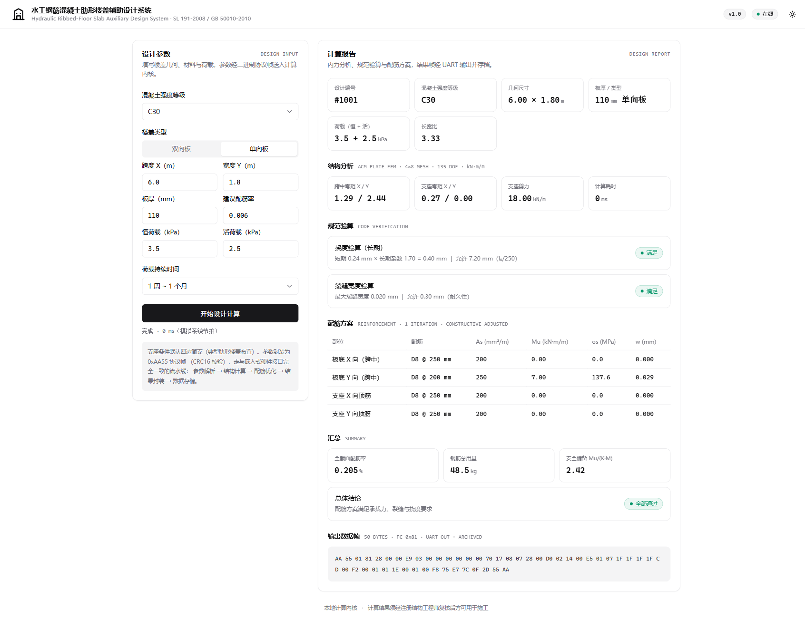

<div align="center">

# Hydraulic Ribbed-Floor Slab Auxiliary Design System

**水工钢筋混凝土肋形楼盖辅助设计系统**

嵌入式楼盖结构设计计算内核 · STM32H743 / FreeRTOS 目标环境 · 附 Web 控制台

[](https://isocpp.org/)
[](#嵌入式移植)
[](LICENSE)
[](#测试)
[](#构建)

</div>

---

无界面、轻量化的肋形楼盖结构设计计算内核：接收二进制协议参数帧，完成
**有限元内力分析 → 挠度 / 裂缝验算 → 配筋优化 → 结果帧封装 → 数据存档**
全流程，输出可直接驱动施工设备的结构化配筋方案。

计算依据《水工混凝土结构设计规范》（SL 191-2008）与
《混凝土结构设计规范》（GB 50010-2010）。

> ⚠️ 本项目输出为**辅助计算结果**，用于实际工程设计前须经注册结构工程师复核。

**姊妹项目**：[ribbed-floor-web](https://github.com/iCxin/ribbed-floor-web) ——
同一算法与协议的**纯前端版**（TypeScript 内核 + React + shadcn 风格 UI），
支持在腾讯云 EdgeOne Pages 一键部署，无需任何本地安装。

## 截图

| 双向板设计报告（亮色） | 暗色主题 | 单向板计算报告 |
| --- | --- | --- |
|  |  |  |

## 特性

- **真实有限元内核** —— ACM 四节点矩形薄板弯单元（每节点 w、∂w/∂x、∂w/∂y），
  形函数由 12 项多项式基数值求逆推导，2×2 高斯积分组装，Cholesky 分解求解；
  自检中与 Timoshenko 简支方板解析解对比，挠度偏差 6.2%、跨中弯矩偏差 4.7%
- **完整嵌入式要素** —— 二进制帧协议（CRC16）、共享内存握手（CRC32 + 标志位）、
  NOR Flash 模拟层（原子写事务 / 磨损均衡 / 哈希索引 / 垃圾回收）、
  FreeRTOS 风格五任务优先级调度
- **规范驱动的配筋优化** —— 以用钢量最小为目标，受弯承载力（K≥1.2）、
  裂缝宽度（≤0.3mm）、长期挠度（≤l₀/250）、最小配筋率与间距构造为约束，
  D8~D25 规格自动匹配，含回溯保护与构造强制修正
- **Web 控制台** —— 同一计算内核的本地 HTTP 服务（仅回环监听），
  shadcn/ui 风格界面（亮 / 暗双主题），参数输入 → 完整设计报告 → 输出帧十六进制
- **零依赖 & 高可移植** —— 纯 C++17 标准库，静态链接单文件（约 0.8MB），
  HAL 层与 STM32 寄存器驱动一一对应，可原样移植至 Keil MDK 工程

## 架构

```
外部设备 ──UART/CAN──▶ [参数解析] ──▶ [结构计算 FEM] ──▶ [配筋优化] ──▶ [结果封装] ──UART──▶ 施工控制器
                         │                 │                 │
                         └─────────────────┴────[数据存储与管理]◀──── 全过程存档
                                             （共享内存 0x24000000 + CRC32 握手）

应用层    五大功能模块（本仓库 src/）
操作系统层 FreeRTOS 五任务调度（PC 端为协作式优先级队列模拟）
驱动层    UART / CAN / NOR Flash / 共享内存（PC 端为接口一致的模拟实现）
硬件层    STM32H743ZI2（Cortex-M7 400MHz + FPU）
```

## 快速开始

```bat
:: Windows 一键构建（自动探测 g++ / MSVC，静态链接）
build.bat

:: 启动 Web 控制台（构建 + 本地服务 + 自动打开浏览器）
web.bat
```

<details>
<summary>CMake / Linux</summary>

```bash
cmake -B build -DCMAKE_BUILD_TYPE=Release
cmake --build build -j
./build/ribbed_floor_design_system --selftest
```

</details>

### 命令行

```bash
ribbed_floor_design_system --selftest    # 39 项系统自检
ribbed_floor_design_system --demo        # 双向板设计演示（6.0m × 4.5m C30）
ribbed_floor_design_system --one-way     # 单向板设计演示（6.0m × 1.8m C30）
ribbed_floor_design_system --web 8080    # Web 控制台（默认 8080，仅 127.0.0.1）
ribbed_floor_design_system --hex <帧>    # 处理外部协议帧（十六进制）
```

### HTTP API

| 端点 | 方法 | 说明 |
| --- | --- | --- |
| `/api/health` | GET | 健康检查 |
| `/api/design` | POST | JSON 参数 → 全流水线 → JSON 设计报告 |
| `/api/frame` | POST | 协议帧 hex → 全流水线 → 结果帧 hex |

```bash
curl -X POST http://127.0.0.1:8080/api/design \
  -d '{"grade":30,"type":1,"span_mm":6000,"width_mm":4500,
       "thickness_mm":120,"ratio":0.004,"dead_kPa":3.0,"live_kPa":2.5,"duration":3}'
```

Web 端与硬件接口走**同一条**处理流水线，计算结果逐位一致。

## 嵌入式移植

1. 将 `include/` 与 `src/`（除 `main.cpp` 按需）加入 Keil MDK 工程（AC6，C++14+）；
2. 以 STM32 HAL / 寄存器实现替换 `src/hal_mock.cpp`：UART DMA 收发、CAN 邮箱、
   NOR Flash 页擦写、系统节拍——函数签名已一一对应；
3. 将 `include/rtos_sim.h` 的任务队列替换为 `xQueueCreate/Send/Receive`，
   按 `include/common_types.h` 中的优先级常量创建五个任务；
4. 共享内存直接映射 `0x24000000` 起始的 AXI SRAM（布局见 `include/hal.h`）。

通信帧格式、参数/结果载荷布局、Flash 记录结构详见 [docs/PROTOCOL.md](docs/PROTOCOL.md)。

## 工程目录

```
├── include/          公共类型 / 协议 / HAL / RTOS 模拟 / 五模块接口 / 控制器 / Web 服务
├── src/              模块实现 + main 入口
├── web/              Web 控制台（单文件，零外部依赖）
├── docs/             通信协议规范 · 界面截图
├── build.bat         Windows 一键构建
├── web.bat           Web 端一键启动
└── CMakeLists.txt
```

## 测试

`--selftest` 包含 39 项断言，全部通过：

| 类别 | 覆盖 |
| --- | --- |
| 校验算法 | CRC16-XMODEM / CRC32-IEEE / MD5 黄金向量 |
| 帧协议 | 组帧-同步-提取自反性、噪声流恢复、畸变检测 |
| 参数解析 | 合法帧 + CRC 畸变 / 强度越界 / 长宽比冲突 / 配筋率越限 / 板厚越限 / 帧丢失 |
| 结构计算 | FEM vs Timoshenko 简支方板解析解（挠度 <8%、弯矩 <15%）、简支边负弯矩 ≈ 0 |
| 数据存储 | 原子写 / 回读一致 / 哈希检索 / 同号覆盖 / 64 条压力 / 磨损均衡极差 ≤ 2 |
| 端到端 | 全流水线、输出帧自反校验、构造合规、设计编号可追溯 |

## 设计约定与适用范围

- 单位：协议层 mm / kPa，算法层 SI（N·m·Pa），报表层 kN·m/m / mm
- 荷载：内力取标准组合（G+Q），承载力验算统一乘结构安全系数 K=1.2
  （SL 191-2008 单一安全系数法）
- 适用：四边支承矩形板、板厚 80~600mm、跨度 0.5~12m、HRB400 钢筋
- **简化假设（使用前必读）**：
  - 板带模型，未显式建模肋梁刚度（肋形楼盖按支承于肋梁的平板处理）；
  - 支座剪力取静力近似值；未包含冲切、受剪及抗震相关验算；
  - 挠度采用"弹性计算 × 长期增大系数"工程方法，未做长期刚度迭代。

## License

[MIT](LICENSE)
